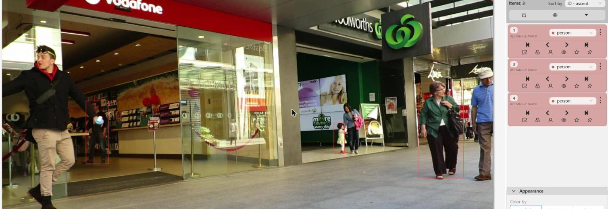
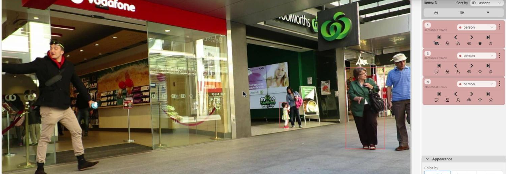
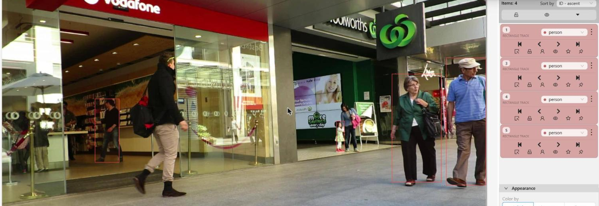

# Báo cáo cá nhân — HoVaTen-MSSV

Đổi tên file theo quy tắc `MSSV_HoTen.md`. Ví dụ: `20241234_NguyenVanAn.md`.

Đoạn video: MOT17-09, 150 frame (frame 1–150), nguồn MOTChallenge, giấy phép CC BY-NC-SA 3.0.

## 0. Thông tin học viên

- Họ tên: Nguyễn Hoàn Thiện
- MSSV: 2A202603123
- Mã đề (A/B/C): A
- Email: nht270605@gmail.com
- Link repository: https://github.com/leejihoon-quant/K5-L2-DAY05-NguyenHoanThien-2A202603123-MOTTracking
- Giờ bắt đầu:
- Giờ kết thúc:

## 1. Xem trước đoạn video (CP0)

Ghi **trước khi vẽ**, mỗi người một dòng.

| Mã | Frame xuất hiện | Frame cuối thấy được | Rẽ / dừng / đổi tốc độ ở frame | Bị che ở frame | Ghi chú |
|---|---|---|---|---|---|
| P1 | 0 | 149 | 20, 32, 56, 80, 100 | 32–55 (mất hẳn 34–48) | |
| P2 | 61 | 149 | 70, 80, 98, 115, 132 | không | |
| P3 | 0 | 149 | 12, 38, 62, 100 (tăng tốc), 125 | không | |
| P4 | 40 | 149 | 50, 60, 70, 100 | không | |
| P5 | 0 | 146 | 25, 50 | 104–146 (mất hẳn 111–134, 147–149) | |

## 2. Keyframe và thời gian (CP1, CP4)

Số keyframe lấy từ kết quả `src/check_submission.py`.

| Mã | Số keyframe | Keyframe ở frame | Số frame có mặt | Keyframe / 100 frame | Thời gian (phút) | Chỗ khó |
|---|---|---|---|---|---|---|
| P1 | 13 | 0, 10, 20, 32, 34, 49, 56, 60, 70, 80, 100, 125, 149 | 135 | 9,6 | | che hoàn toàn f34–48 |
| P2 | 7 | 61, 70, 80, 98, 115, 132, 149 | 89 | 7,9 | | người nhỏ sau kính/quầy |
| P3 | 15 | 0, 12, 25, 38, 50, 62, 75, 88, 100, 112, 125, 135, 140, 145, 149 | 150 | 10,0 | | tăng tốc, lớn dần, túi xách làm box hẹp |
| P4 | 9 | 40, 50, 60, 70, 90, 100, 110, 120, 149 | 110 | 8,2 | | vào từ mép phải, lớn dần |
| P5 | 14 | 0, 25, 50, 75, 100, 104, 108, 111, 135, 138, 141, 144, 145, 147 | 123 | 11,4 | | người nhỏ, bị che nhiều lần |
| **Tổng** | 58 | | 607 | 9,6 | | |

Keyframe / 100 frame của cả bài = tổng keyframe ÷ tổng số frame có mặt × 100 = 58 ÷ 607 × 100 = 9,6

Bạn đặt keyframe nhiều nhất ở người nào? Vì sao (người đó rẽ, dừng, lại gần camera hay bị che)?

P3 (15 keyframe), vì bà lại gần camera, đổi tốc độ rõ (chậm đến khoảng f90, nhanh hẳn sau f100) và lớn dần, nên box dễ trôi nếu keyframe thưa.

## 3. Đoạn bị che (CP2)

Người bị che: `P1`

| Mốc | Frame |
|---|---:|
| Bắt đầu bị che một phần (bật `occluded`) | 32 |
| Mất hẳn (bật `outside`) | 34 |
| Hiện lại (tắt `outside`) | 49 |
| Thấy rõ trở lại (tắt `occluded`) | 56 |

- Thời gian khuất hẳn: 15 frame = 0,5 giây.
- Quyết định: giữ cùng ID.
- Lý do (trả lời 3 câu: khuất bao lâu so với 60 frame, ngoại hình có khớp, chỗ hiện lại có đúng hướng và tốc độ):

Khuất hẳn 15 frame, ít hơn nhiều so với ngưỡng 60 frame. Ngoại hình khớp (áo đen, quần jean, cùng dáng người) và không có người nào khác thay thế ở vị trí đó. Chỗ hiện lại (f49) liền kề vị trí trước khi bị che (f32) và người tiếp tục đi sang phải với tốc độ chậm như trước.

Ảnh chụp màn hình:





## 4. Tự review ID (CP3)

Lượt 1 theo người (đi ngược từ frame 149 về 0 trên CVAT), lượt 2 theo cảnh (nhảy 10 frame). Ít nhất 3 dòng; không có lỗi thì ghi một dòng "đã kiểm hai lượt, không lỗi".

Loại lỗi dùng đúng một trong 7 mã: `id_switch`, `fragmentation`, `lost`, `merge`, `false_track`, `drift`, `flag`.

| Frame | Mã người | Loại lỗi | Mô tả một câu | Phát hiện ở lượt | Đã sửa? |
|---:|---|---|---|---|---|
| 38–100 | P3 | `drift` | Box hẹp, không ôm túi xách và tay giữa hai keyframe thưa | | Có |
| 104–149 | P5 | `flag` | Gán `occluded` liên tục, thiếu `outside` ở f111–134 và f147–149 | | Có |
| 32 | P1 | `drift` | Box nhảy ngược về vị trí f0, lệch khỏi người | | Có |
| 34–48 | P1 | `flag` | Bị che hoàn toàn nhưng thiếu `outside` | | Có |
| 98–149 | P2 | `drift` | Box lệch khỏi người, không ôm tay và dây đeo | | Có |

Tổng hợp số lỗi theo loại:

| `id_switch` | `fragmentation` | `lost` | `merge` | `false_track` | `drift` | `flag` |
|---:|---:|---:|---:|---:|---:|---:|
| 0 | 0 | 0 | 0 | 0 | 3 | 2 |

Lỗi nào chỉ lượt 2 (theo cảnh) mới thấy, lượt 1 (theo người) không thấy? Vì sao?

...

## 5. File xuất và kết quả tự kiểm (CP4)

| Kiểm tra | Kết quả |
|---|---|
| Tên file MOT 1.1 | `src/exports/NguyenHoanThien_mot.zip` (bên trong `gt/gt.txt`, không kèm ảnh) |
| Tên file CVAT for video 1.1 | `src/exports/NguyenHoanThien_cvat_video.zip` (bên trong `annotations.xml`, không kèm ảnh) |
| Số track ID khác nhau trong `gt/gt.txt` (phải là 5) | 5 (tổng 607 box) |
| Frame `outside` không có dòng trong `gt.txt` (đúng / sai) | Đúng: P1 `outside` f34–48 và P5 `outside` f111–134, f147–149 không có dòng nào trong `gt.txt` (P1: 135 frame có mặt; P5 có dòng đến f146, 123 frame) |
| Job đã completed trên CVAT máy cá nhân | Đúng |

Vị trí các file trong repo (`https://github.com/leejihoon-quant/K5-L2-DAY05-NguyenHoanThien-2A202603123-MOTTracking`):

- `src/exports/NguyenHoanThien_mot.zip`
- `src/exports/NguyenHoanThien_cvat_video.zip`
- `report/individual/2A202603123_NguyenHoanThien.md` (báo cáo này)
- `report/individual/images/che_1_truoc.png`, `che_2_giua.png`, `che_3_sau.png`

Dán phần tóm tắt in ra từ `src/check_submission.py` (chạy trên hai file trong `src/exports/`):

```text
=== File MOT 1.1: NguyenHoanThien_mot.zip ===
  Số track ID: 5   |   Tổng số box: 607
  [OK]        Đúng 5 track ID.

  Track | Frame có mặt | Số frame | Đoạn vắng (outside)
      1 |   0–149      |      135 | 34–48
      2 |   0–149      |      150 | -
      3 |   0–146      |      123 | 111–134
      4 |  40–149      |      110 | -
      5 |  61–149      |       89 | -

=== File CVAT for video 1.1: NguyenHoanThien_cvat_video.zip ===

  Track | Nhãn   | Frame thấy | Keyframe | KF/100 frame | Frame occluded | Lần bật outside
      0 | person |        135 |       12 |          8.9 |              9 |               1
              Track 0: keyframe ở frame [0, 10, 20, 32, 49, 56, 60, 70, 80, 100, 125, 149]
      1 | person |         89 |        7 |          7.9 |              0 |               0
              Track 1: keyframe ở frame [61, 70, 80, 98, 115, 132, 149]
      2 | person |        150 |       15 |         10.0 |              0 |               0
              Track 2: keyframe ở frame [0, 12, 25, 38, 50, 62, 75, 88, 100, 112, 125, 135, 140, 145, 149]
      3 | person |        123 |       13 |         10.6 |             15 |               2
              Track 3: keyframe ở frame [0, 25, 50, 75, 100, 104, 108, 110, 135, 138, 141, 144, 145]
      4 | person |        110 |        9 |          8.2 |              0 |               0
              Track 4: keyframe ở frame [40, 50, 60, 70, 90, 100, 110, 120, 149]

  Tổng: 56 keyframe / 607 frame có mặt = 9.2 keyframe / 100 frame
  [OK]        Đọc được 5 track từ annotations.xml.

=== Tóm tắt ===
  Lỗi: 0   |   Cảnh báo: 0
  Đạt. Dán phần tóm tắt này vào báo cáo mục 5.
```

Ghi chú đối chiếu: theo script, số keyframe là P1 12, P2 7, P3 15, P5 13, P4 9 (tổng 56, 9,2 / 100 frame). Script không đếm các keyframe đặt ở frame `outside` (P1 f34; P5 f111, f147). Đếm cả keyframe `outside` trong `annotations.xml` thì P1 = 13 và P5 = 15 (0, 25, 50, 75, 100, 104, 108, 110, 111, 135, 138, 141, 144, 145, 147); bảng mục 2 ghi P5 = 14 và không có keyframe f110.

## 6. Ba câu kết

1. Nếu được gán lại, bạn sẽ đặt keyframe khác ở đâu? Vì sao?

   Tôi đặt keyframe ngay ở chỗ người đổi nhịp đi (P3 quanh f90–f100) thay vì rải đều, và bỏ keyframe ở đoạn đi thẳng đều. Với P2 và P5 là người nhỏ, tôi thêm keyframe ngay trước và sau đoạn che để box không trôi.

2. Có chỗ nào bạn không chắc "cùng ID hay ID mới"? Bạn đã quyết định và ghi chú thế nào?

   P5 (bé gái) bị che hoàn toàn f111–134 (24 frame) rồi hiện lại ở f135 cùng vị trí giữa bà áo xanh và ông áo xanh dương; P1 bị che f34–48. Cả hai dưới 60 frame và vị trí liên tục nên tôi giữ cùng ID, ghi chú ở mục 3 và dùng `outside` cho các frame mất hẳn.

3. Một lỗi ID trong job của bạn (nếu không còn sót, chọn lỗi đã sửa) có thể làm xe tự lái dự đoán sai chuyển động của người đó như thế nào? Lỗi đó ảnh hưởng MOTA hay IDF1 nhiều hơn?

   Lỗi đã sửa: P1 ở f34–48 bị che hoàn toàn nhưng thiếu `outside`, nên nhãn có box nằm ở chỗ người đi ngang qua. Khi đó ID của P1 có thể bị gán nhầm sang người đi ngang, xe sẽ dự đoán chuyển động của người đứng gần quầy theo quỹ đạo người kia (đi nhanh sang phải) và dự đoán sai hướng và tốc độ. Lỗi này ảnh hưởng IDF1 nhiều hơn MOTA, vì IDF1 đo mức nhất quán danh tính trên cả quỹ đạo, còn MOTA chỉ phạt mỗi lần đổi ID một lần.

## Bonus (nếu làm)

### B1 — Hai người đi sát

...

### B2 — So cách đặt keyframe

| Cách đặt | Số keyframe | Frame trôi nhất | Ghi chú |
|---|---:|---:|---|
| Đều mỗi 30 frame | 6 | 100 | P3, IoU 0,698 so với track chính |
| Theo chỗ đổi hướng | 15 | | P3, làm chuẩn so sánh |

Nội suy tuyến tính giả định vận tốc không đổi giữa hai keyframe. Ở đoạn f90–f120, P3 đi chậm (khoảng 3,8 px/frame) rồi nhanh hẳn (khoảng 10 px/frame), nên box phụ chạy trước người thật và trôi nhất ở f100 (IoU 0,698).

### B3 — So với tracker có sẵn

| Frame | Mã người | Tracker làm gì | Nhãn của bạn | Giải thích (đoán rồi sửa / ghép IoU / box score thấp / ngoại hình) |
|---:|---|---|---|---|
| | | | | |
| | | | | |

## 7. Tài liệu tham khảo và công cụ AI đã dùng

RUBRIC.md, CHECKPOINTS.md, ảnh đề A. Công cụ AI: Claude (Anthropic) qua Claude in Chrome, dùng để rà box, thêm keyframe bằng API CVAT và soạn báo cáo.
